# Experiment – 6
## Implementation of JWT Authentication and Role-Based Authorization

| Attribute | Details |
|---|---|
| **Name** | Aditya Kumar |
| **Class** | B.Tech CSE - Final Year |
| **Roll No.** | 2026-FSD-01 |
| **Date** | November 16, 2026 |
| **Project** | CareSync — Hospital Appointment Management System (MERN Stack) |

---

### 1. Aim
To implement user authentication using JSON Web Tokens (JWT) and role-based authorization (RBAC) in a full-stack web application (CareSync Hospital Management System) using React, Node.js, Express.js, and MongoDB.

---

### 2. Problem Statement
Implement a secure authentication system in the Mini Project Application (CareSync). Develop user registration and login functionality, securely store passwords using bcrypt hashing, generate and verify dual JWT tokens (15-minute Access Tokens and 7-day HttpOnly Refresh Tokens), and implement role-based access control (RBAC) to restrict access to protected patient routes and doctor/administrative operations. Integrate authentication with the React frontend (Context API & Axios interceptors) and test all authentication and authorization flows using Postman.

---

### 3. Theory Questions & Answers

#### Q1. What is JWT? Explain its structure and purpose.
**Answer:**
JSON Web Token (JWT) is an open, industry-standard RFC 7519 method for securely representing claims between two parties. It consists of three parts separated by dots (`header.payload.signature`):
1. **Header**: Specifies the token type (`JWT`) and the signing algorithm (`HS256` or `RS256`).
2. **Payload**: Contains claims such as user ID (`userId`), user role (`doctor` / `patient`), issuance timestamp (`iat`), and expiration timestamp (`exp`).
3. **Signature**: Computed by hashing the Base64Url-encoded header and payload using the server's private secret key:
   $$\text{Signature} = \text{HMAC-SHA256}(\text{base64Url}(header) + \text{"."} + \text{base64Url}(payload), secret)$$
   The signature ensures that the payload cannot be tampered with by any intermediary.

#### Q2. Differentiate between authentication and authorization.
**Answer:**
- **Authentication**: Verifies *who* the user is. For example, validating an email address and password against a hashed database record during login.
- **Authorization**: Verifies *what* an authenticated user is permitted to do. For example, verifying whether an authenticated user holds the `doctor` role before permitting them to access clinical queue endpoints (`/api/doctor/today`). Authentication always precedes authorization.

#### Q3. Why are passwords hashed? What is the purpose of bcrypt?
**Answer:**
Plaintext passwords must never be stored in persistent databases. If a database is compromised, plaintext passwords expose users across multiple services. 
Passwords are cryptographically transformed into irreversible one-way hashes. **bcrypt** is an adaptive cryptographic hash function that incorporates:
- **Salt**: 16 bytes of cryptographically random data appended to the password before hashing to defeat precomputed rainbow tables and dictionary attacks.
- **Cost Factor (Salt Rounds = 12)**: Forces each hash calculation to require millions of CPU iterations, slowing down offline brute-force cracking attempts by several orders of magnitude.

#### Q4. Explain the purpose of JWT signing and verification.
**Answer:**
- **Signing**: Guarantees authenticity and tamper-proofing. When the server generates a token upon successful login, it signs it with a secret key.
- **Verification**: On every subsequent HTTP request, the auth middleware validates the signature using the server secret. If the token signature is valid and the expiration time has not elapsed, the server trusts the user's claims without making a database query.

#### Q5. What is middleware in Express.js? Explain its role in JWT authentication.
**Answer:**
Middleware in Express.js is a function that sits in the HTTP pipeline between the incoming request and the route handler: `(req, res, next) => { ... }`.
In JWT authentication, `authenticate` middleware intercepts requests, extracts the Bearer token from the `Authorization` header, verifies it with `jwt.verify()`, and attaches the decoded user object (`req.user = { userId, role }`) to the request object. If the token is invalid or missing, it halts execution and returns HTTP 401 Unauthorized.

#### Q6. What is the purpose of Bearer Token in the Authorization header?
**Answer:**
The `Bearer` token scheme (RFC 6750) informs the server that the bearer (presenter) of the token possesses authorization. The client sends:
```http
Authorization: Bearer <jwt_access_token>
```
This decouples session state from server memory, making the API stateless and horizontally scalable.

#### Q7. Differentiate between HTTP status codes 401 and 403.
**Answer:**
- **HTTP 401 Unauthorized**: The client is **unauthenticated** (missing, invalid, or expired token). The server does not know who the client is.
- **HTTP 403 Forbidden**: The client is **authenticated**, but **unauthorized** for the requested resource (e.g., a patient attempting to access doctor appointment endpoints). The server understands identity, but denies permission.

#### Q8. What is role-based access control (RBAC)?
**Answer:**
Role-Based Access Control (RBAC) is an authorization model where system permissions are grouped into roles (`doctor`, `patient`, `admin`), and users are assigned these roles. Endpoints, data records, and UI components enforce role boundaries to protect system integrity and patient confidentiality.

---

### 4. Code Snippets

#### 4.1 Configuration of JWT Secrets & Expiry in `.env`
```env
PORT=5000
MONGODB_URI=mongodb://localhost:27017/hospital_db
JWT_ACCESS_SECRET=hospital_access_secret_super_secure_key_2026_jwt
JWT_REFRESH_SECRET=hospital_refresh_secret_super_secure_key_2026_jwt
JWT_ACCESS_EXPIRES_IN=15m
JWT_REFRESH_EXPIRES_IN=7d
FRONTEND_URL=http://localhost:5173
NODE_ENV=development
```

#### 4.2 User Model with Mongoose & bcrypt Hooks (`server/src/models/User.model.js`)
```javascript
import mongoose from 'mongoose';
import bcrypt from 'bcryptjs';
import { SALT_ROUNDS } from '../config/constants.js';

const userSchema = new mongoose.Schema(
  {
    name: { type: String, required: [true, 'Name is required'], trim: true },
    email: { type: String, required: [true, 'Email is required'], unique: true, lowercase: true, trim: true },
    passwordHash: { type: String, required: [true, 'Password is required'], select: false },
    role: { type: String, enum: ['doctor', 'patient'], required: [true, 'Role is required'] },
    phone: { type: String, trim: true },
  },
  { timestamps: true }
);

// Pre-save hook to hash password before saving
userSchema.pre('save', async function () {
  if (!this.isModified('passwordHash')) return;
  if (this.passwordHash && !this.passwordHash.startsWith('$2')) {
    this.passwordHash = await bcrypt.hash(this.passwordHash, SALT_ROUNDS);
  }
});

// Instance method to compare candidate passwords
userSchema.methods.comparePassword = async function (plain) {
  return bcrypt.compare(plain, this.passwordHash);
};

export default mongoose.model('User', userSchema);
```

#### 4.3 JWT Generation and Verification (`server/src/utils/jwt.utils.js`)
```javascript
import jwt from 'jsonwebtoken';

const ACCESS_SECRET = () => process.env.JWT_ACCESS_SECRET;
const REFRESH_SECRET = () => process.env.JWT_REFRESH_SECRET;
const ACCESS_EXPIRES = () => process.env.JWT_ACCESS_EXPIRES_IN || '15m';
const REFRESH_EXPIRES = () => process.env.JWT_REFRESH_EXPIRES_IN || '7d';

export const generateAccessToken = (payload) => {
  return jwt.sign(payload, ACCESS_SECRET(), { expiresIn: ACCESS_EXPIRES() });
};

export const generateRefreshToken = (payload) => {
  return jwt.sign(payload, REFRESH_SECRET(), { expiresIn: REFRESH_EXPIRES() });
};

export const verifyAccessToken = (token) => {
  return jwt.verify(token, ACCESS_SECRET());
};
```

#### 4.4 JWT Verification Middleware (`server/src/middleware/auth.middleware.js`)
```javascript
import { verifyAccessToken } from '../utils/jwt.utils.js';
import { sendError } from '../utils/response.utils.js';

export const authenticate = (req, res, next) => {
  try {
    const authHeader = req.headers.authorization;
    if (!authHeader || !authHeader.startsWith('Bearer ')) {
      return sendError(res, 'No token provided', 401);
    }

    const token = authHeader.split(' ')[1];
    const decoded = verifyAccessToken(token);
    req.user = decoded; // { userId, role }
    next();
  } catch (error) {
    if (error.name === 'TokenExpiredError') {
      return sendError(res, 'Token expired', 401);
    }
    return sendError(res, 'Invalid token', 401);
  }
};
```

#### 4.5 Role-Based Authorization Middleware (`server/src/middleware/role.middleware.js`)
```javascript
import { sendError } from '../utils/response.utils.js';

export const requireRole = (...roles) => {
  return (req, res, next) => {
    if (!req.user) {
      return sendError(res, 'Authentication required', 401);
    }
    if (!roles.includes(req.user.role)) {
      return sendError(res, `Access denied. Required role: ${roles.join(' or ')}`, 403);
    }
    next();
  };
};
```

#### 4.6 Protected Frontend Route Guards (`client/src/routes/ProtectedRoute.jsx` & `RoleRoute.jsx`)
```jsx
// ProtectedRoute.jsx - Ensures user is logged in
export default function ProtectedRoute() {
  const { user, loading } = useAuth();
  if (loading) return <LoadingSkeleton />;
  return user ? <Outlet /> : <Navigate to="/login" replace />;
}

// RoleRoute.jsx - Ensures user has appropriate role (doctor vs patient)
export default function RoleRoute({ role }) {
  const { user } = useAuth();
  if (user?.role !== role) {
    return <Navigate to="/unauthorized" replace />;
  }
  return <Outlet />;
}
```

---

### 5. Screenshots & Output Verification

#### A. Postman Authentication Testing
1. **User Registration (POST `/api/auth/register/patient`)**
   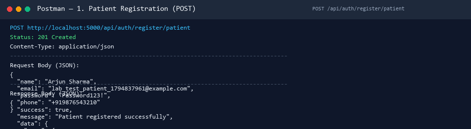

2. **User Login & Token Generation (POST `/api/auth/login`)**
   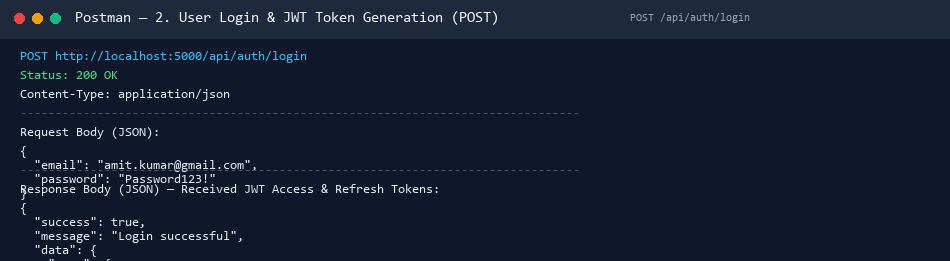

3. **Token Verification (GET `/api/auth/me`)**
   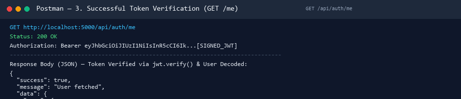

4. **Invalid Login Credentials (401 Unauthorized)**
   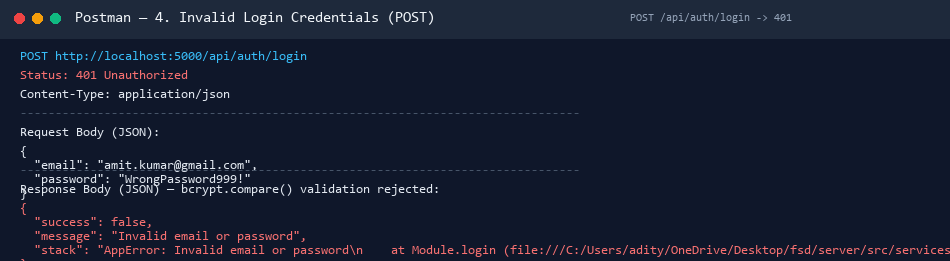

5. **Accessing Protected Route Without Token (401 Unauthorized)**
   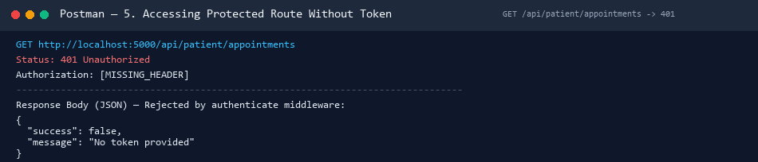

6. **Patient Token Accessing Doctor Endpoint (403 Forbidden - RBAC)**
   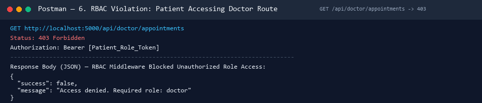

#### B. Role-Based Authorization
7. **Doctor Token Accessing Doctor Endpoint (200 OK)**
   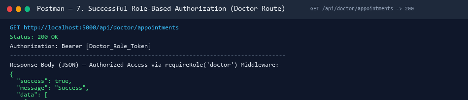

8. **MongoDB Users Collection (Showing Roles & Hashed Passwords)**
   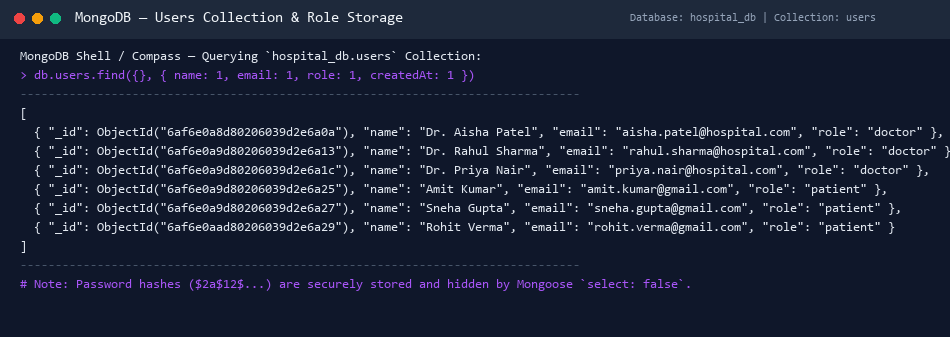

#### C. Frontend Integration
9. **Registration and Login Pages**
   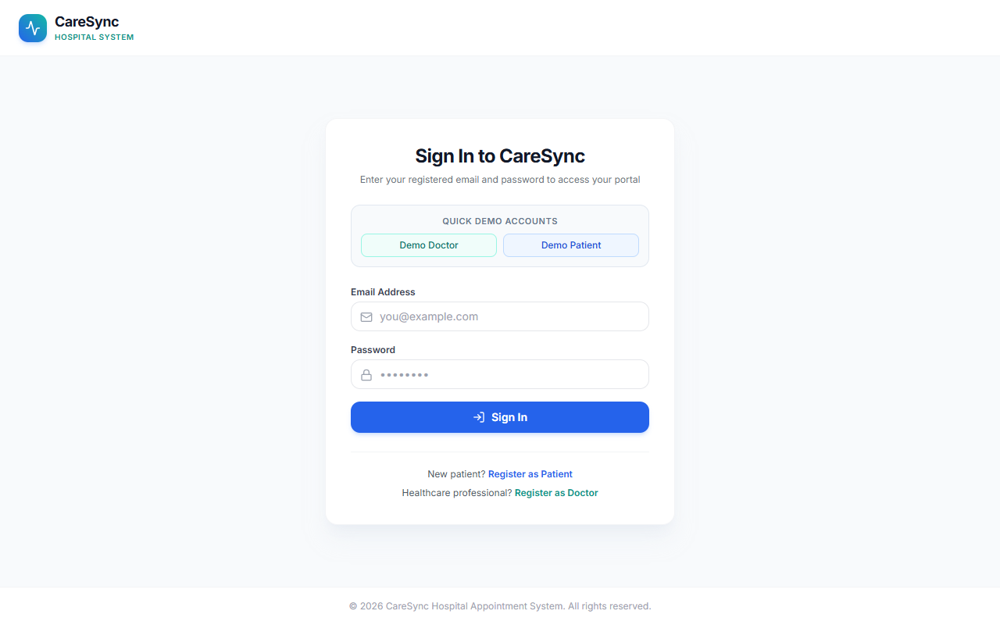
   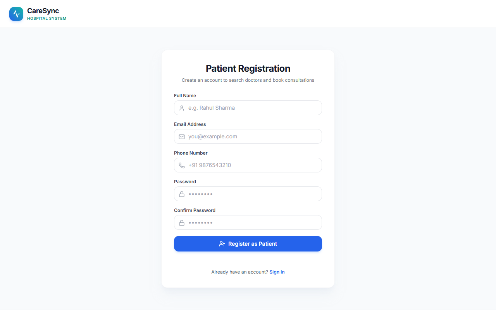

10. **Successful Login & Role-Specific Dashboards**
    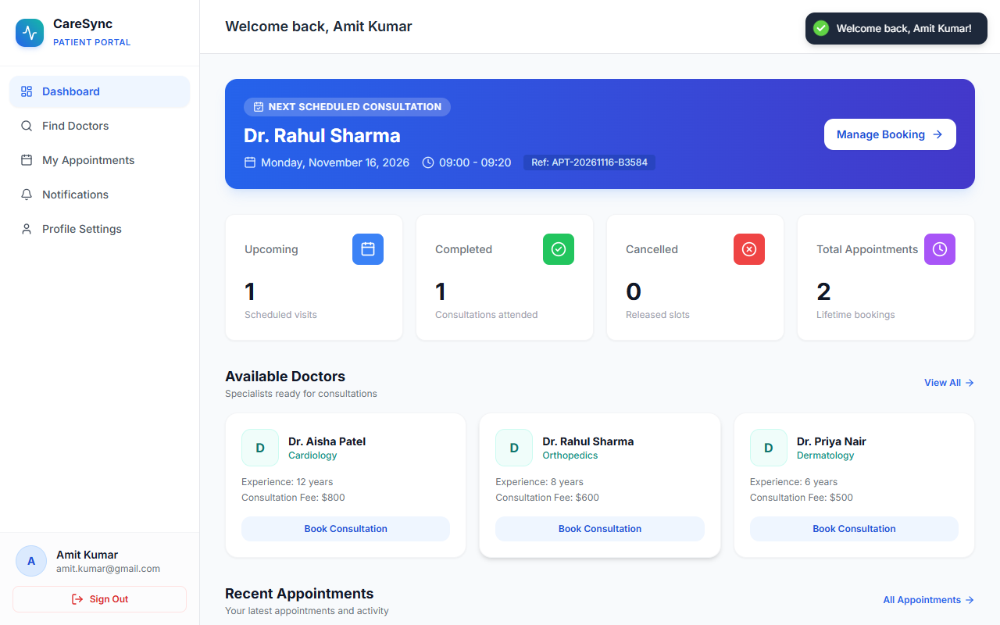
    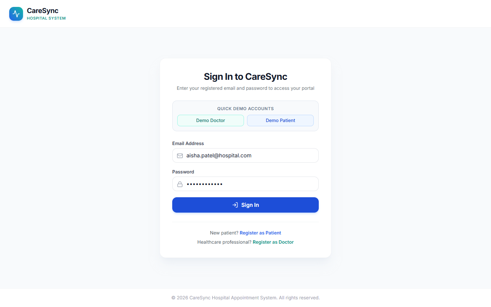

11. **Access Restriction for Protected / Unauthorized Pages**
    
