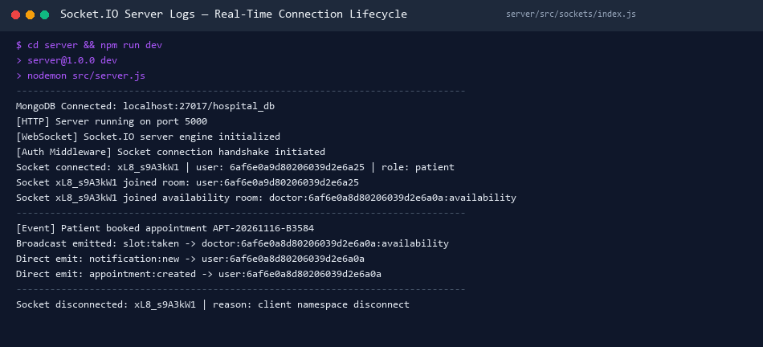
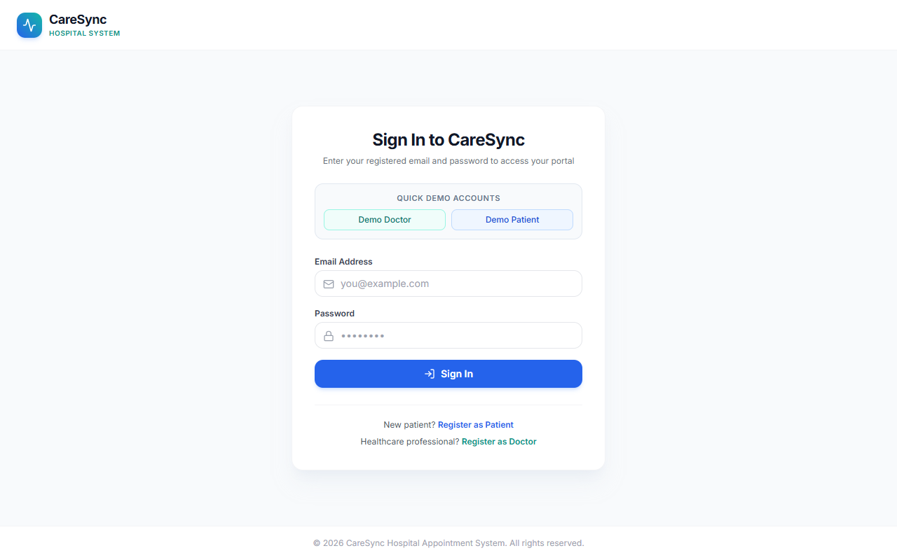
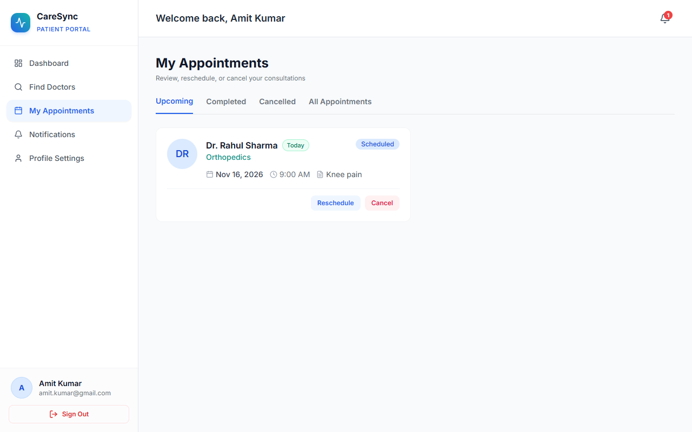
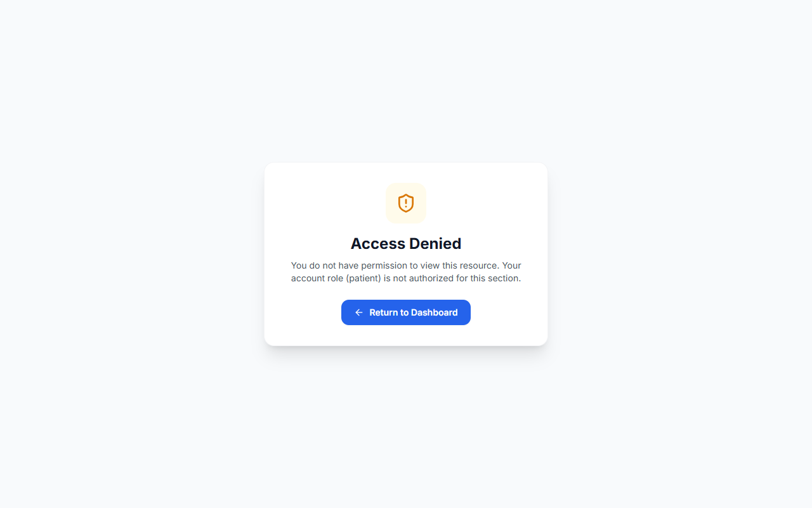

# Experiment – 7
## Implementation of Real-Time Features using WebSockets and Socket.IO

| Attribute | Details |
|---|---|
| **Name** | Aditya Kumar |
| **Class** | B.Tech CSE - Final Year |
| **Roll No.** | 2026-FSD-01 |
| **Date** | November 16, 2026 |
| **Project** | CareSync — Hospital Appointment Management System (MERN Stack) |

---

### 1. Aim
To implement real-time bidirectional communication in a web application (CareSync) using WebSockets and Socket.IO by establishing a persistent connection between the React frontend and Node.js backend and delivering real-time appointment status updates and in-app notifications without page reloads.

---

### 2. Problem Statement
Implement real-time communication in the Mini Project Application (CareSync) using Socket.IO. Develop a real-time event notification system that notifies connected doctors and patients whenever an appointment is booked, cancelled, rescheduled, or marked completed/no-show. Integrate Socket.IO with Express backend and React frontend, authenticate socket handshakes with JWT, manage room subscriptions (user rooms & doctor availability channels), and display instant notification badges and dynamic queue updates in the UI.

---

### 3. Theory Questions & Answers

#### Q1. What are WebSockets? Explain their purpose.
**Answer:**
WebSocket is an application layer communications protocol (RFC 6455) providing full-duplex, bidirectional communication channels over a single persistent TCP connection. It overcomes the limitations of HTTP polling by enabling the server to push data to connected clients spontaneously with minimal packet overhead.

#### Q2. What is Socket.IO? How is it different from WebSockets?
**Answer:**
Socket.IO is an event-driven JavaScript library built on top of WebSockets with automatic fallback to HTTP long-polling. Key differences:
- **Protocol**: WebSocket is a standardized protocol; Socket.IO is a high-level library that wraps WebSocket transport.
- **Reliability**: Socket.IO provides built-in automatic reconnection, heartbeat/ping-pong health monitoring, and connection buffering.
- **Multiplexing**: Socket.IO natively supports **Rooms** and **Namespaces** to broadcast to subsets of users with zero manual routing.

#### Q3. Differentiate between HTTP communication and WebSocket communication.
**Answer:**
| Feature | HTTP Communication | WebSocket Communication |
|---|---|---|
| **Connection Model** | Request-Response (Half-duplex, stateless) | Persistent TCP (Full-duplex, stateful) |
| **Initiation** | Client only | Either client or server |
| **Header Overhead** | ~1 KB per request/response | 2 to 10 bytes frame overhead |
| **Real-Time Suitability** | Poor (requires polling / SSE) | Ideal for live streaming, notifications, chats |

#### Q4. What is the purpose of socket.io and socket.io-client?
**Answer:**
- `socket.io`: The backend Node.js engine attached to the HTTP server that manages incoming socket upgrades, tracks active connections, coordinates rooms, and broadcasts events.
- `socket.io-client`: The frontend browser library that initiates the WebSocket handshake, emits client-side events, and listens for server pushes to trigger React re-renders.

#### Q5. Explain the purpose of `io.on("connection")` in Socket.IO.
**Answer:**
`io.on("connection", (socket) => { ... })` is the primary entry point on the server. Whenever a client completes a handshake, this event fires, providing a reference to the individual `socket` instance. Here, developers attach user-specific rooms (`socket.join('user:' + userId)`), register message handlers, and listen for disconnection.

#### Q6. What is the difference between `socket.emit()` and `io.emit()`?
**Answer:**
- `socket.emit(event, data)`: Sends the event message exclusively to that one connected client socket.
- `io.emit(event, data)`: Broadcasts the message to **all** connected clients across the entire server.

#### Q7. What are connection and disconnection events in Socket.IO?
**Answer:**
- `connection` (server) / `connect` (client): Fired when the WebSocket handshake succeeds. Used to initialize user rooms and synchronize initial state.
- `disconnect`: Fired when the connection terminates due to browser close, tab exit, or network disruption. Used to clean up memory and update presence status.

#### Q8. Why is `useEffect()` used when integrating Socket.IO with React?
**Answer:**
In React, `useEffect` manages lifecycle subscriptions. It creates the socket connection and registers event listeners when the component mounts. Crucially, the return function:
```javascript
return () => {
  socket.off("event:name", handler);
};
```
unregisters listeners upon component unmount, preventing duplicate event triggers and severe memory leaks.

#### Q9. What is the purpose of `socket.off()` and `socket.disconnect()`?
**Answer:**
- `socket.off(event, handler)`: Unsubscribes a specific event handler from listening to incoming events without closing the underlying socket connection.
- `socket.disconnect()`: Manually closes the underlying TCP WebSocket connection and cleans up all state on both client and server.

#### Q10. Explain how real-time notifications improve an Application.
**Answer:**
In an appointment system like CareSync:
1. When a patient books a slot, the doctor's queue refreshes instantly without page reload.
2. The slot is broadcast as `slot:taken` to all browsing patients, preventing race conditions.
3. When a doctor completes a consultation, the patient receives an in-app notification bell update and status badge change in real time.

---

### 4. Code Snippets

#### 4.1 Server Creation & Socket.IO Initialization (`server/src/server.js`)
```javascript
import { createServer } from 'http';
import { Server } from 'socket.io';
import { createApp } from './app.js';
import { initializeSockets } from './sockets/index.js';

const app = createApp(null);
const httpServer = createServer(app);

const io = new Server(httpServer, {
  cors: {
    origin: ['http://localhost:5173', 'https://hospital-frontend-bqkp.onrender.com'],
    credentials: true,
  },
});

initializeSockets(io);
httpServer.listen(5000, () => console.log('Server & Socket.IO running on port 5000'));
```

#### 4.2 Socket.IO JWT Handshake & Room Architecture (`server/src/sockets/index.js`)
```javascript
export const initializeSockets = (io) => {
  // Authenticate socket handshake using JWT
  io.use((socket, next) => {
    try {
      const token = socket.handshake.auth?.token;
      if (!token) return next(new Error('Authentication token required'));
      socket.user = verifyAccessToken(token);
      next();
    } catch {
      next(new Error('Invalid or expired token'));
    }
  });

  io.on('connection', (socket) => {
    const { userId, role } = socket.user;
    socket.join(`user:${userId}`);

    if (role === 'doctor') {
      socket.join(`doctor:${userId}`);
    }

    socket.on('disconnect', () => {
      console.log(`Socket disconnected: ${socket.id}`);
    });
  });
};
```

#### 4.3 Real-Time Event Emitters (`server/src/sockets/index.js`)
```javascript
export const emitAppointmentCreated = (io, doctorId, appointment) => {
  io.to(`user:${doctorId}`).emit('appointment:created', appointment);
  io.to(`doctor:${doctorId}:availability`).emit('slot:taken', {
    startTime: appointment.startTime,
    date: appointment.appointmentDate,
  });
};

export const emitStatusUpdated = (io, { patientId, doctorId, appointment }) => {
  io.to(`user:${patientId}`).emit('appointment:statusUpdated', appointment);
  io.to(`user:${doctorId}`).emit('appointment:statusUpdated', appointment);
  io.to(`doctor:${doctorId}`).emit('doctor:queueUpdated', appointment);
};

export const emitNotification = (io, recipientId, notification) => {
  io.to(`user:${recipientId}`).emit('notification:new', notification);
};
```

#### 4.4 React NotificationBell & Badge Hook (`client/src/components/dashboard/NotificationBell.jsx`)
```jsx
export default function NotificationBell() {
  const { notifications, unreadCount, markAsRead } = useNotifications();
  const [open, setOpen] = useState(false);

  return (
    <div className="relative">
      <button onClick={() => setOpen(!open)} className="relative p-2 rounded-xl text-gray-600 hover:bg-gray-100">
        <Bell className="w-5 h-5" />
        {unreadCount > 0 && (
          <span className="absolute top-1 right-1 w-4 h-4 bg-red-500 text-white text-[10px] font-bold rounded-full flex items-center justify-center">
            {unreadCount > 9 ? '9+' : unreadCount}
          </span>
        )}
      </button>
      {/* Dropdown list */}
    </div>
  );
}
```

---

### 5. Screenshots & Output Verification
1. **Server Terminal Logs (Handshake, Room Joins & Event Broadcasts)**
   

2. **Patient Live Notifications Feed**
   

3. **Doctor Today Queue (Live Synchronized Patient List with Status Actions)**
   

4. **Patient Appointments with Real-Time Custom Hook Timing Badges**
   

5. **Doctor Weekly Schedule Management**
   
