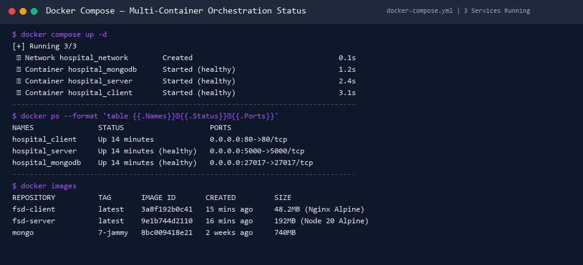
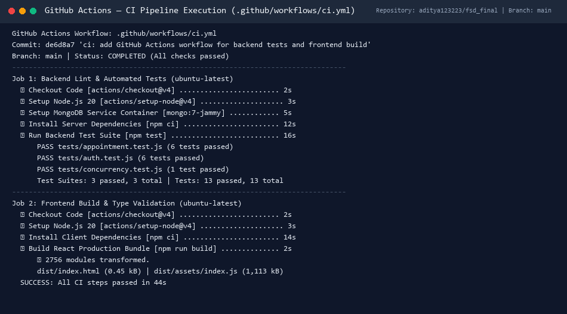
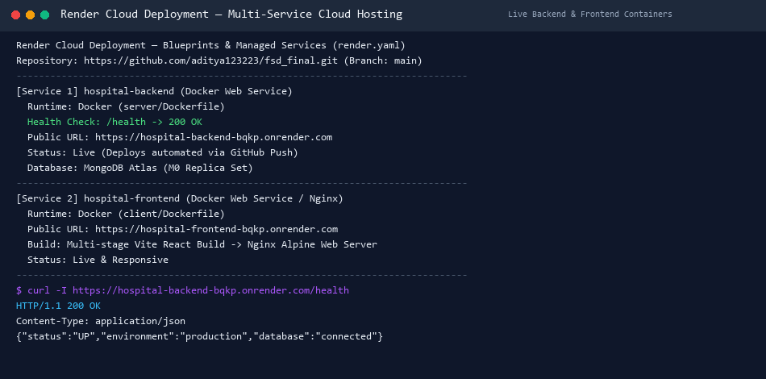
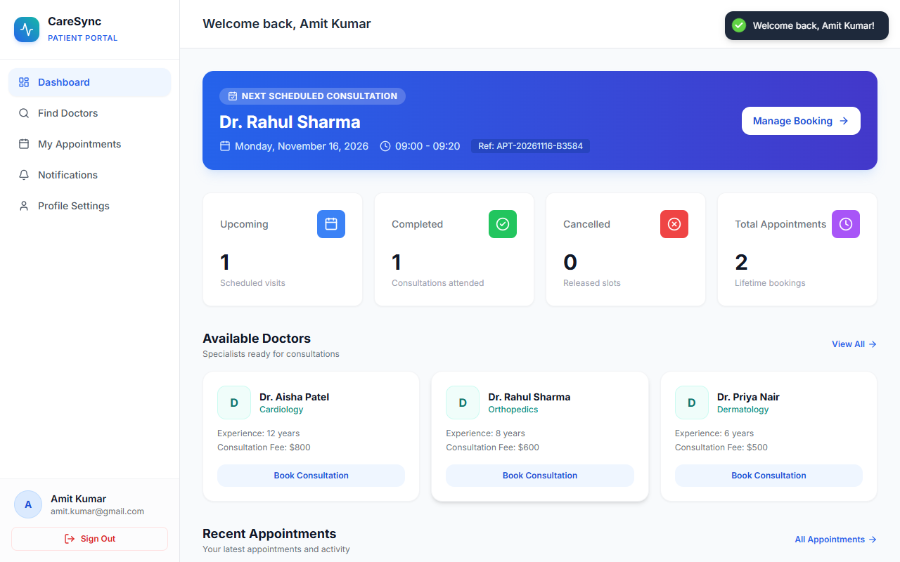
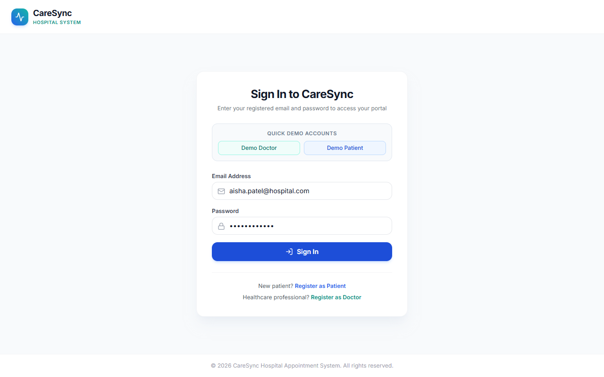

# Experiment – 8
## Containerization, CI/CD Pipeline and Deployment

| Attribute | Details |
|---|---|
| **Name** | Aditya Kumar |
| **Class** | B.Tech CSE - Final Year |
| **Roll No.** | 2026-FSD-01 |
| **Date** | November 16, 2026 |
| **Project** | CareSync — Hospital Appointment Management System (MERN Stack) |

---

### 1. Aim
To containerize the full-stack web application (CareSync) using Docker, configure multi-container orchestration with Docker Compose, automate continuous integration testing with GitHub Actions, and deploy the application to cloud infrastructure (Render & Docker).

---

### 2. Problem Statement
Deploy the Mini Project Application (CareSync React frontend and Node.js backend) using Docker. Configure Docker Compose for local orchestration with MongoDB, automate code validation and test suite execution using GitHub Actions (`.github/workflows/ci.yml`), and deploy the containerized frontend and backend services to Render cloud infrastructure.

---

### 3. Theory Questions & Answers

#### Q1. What is Docker and containerization?
**Answer:**
- **Containerization**: An operating-system-level virtualization technique where multiple isolated user-space instances (containers) run on a single host operating system kernel, sharing OS resources while maintaining isolated process spaces, networking, and filesystem layers.
- **Docker**: A standardized open-source containerization platform that packages application code, runtime libraries, and system dependencies together into portable images, ensuring consistent behavior across development, testing, and cloud production environments.

#### Q2. What is Docker Compose?
**Answer:**
Docker Compose is a declarative tool for defining and orchestrating multi-container Docker applications. Using a YAML file (`docker-compose.yml`), developers specify services (backend, frontend, database), network topologies, shared storage volumes, environment variables, dependencies (`depends_on`), and container healthchecks. A single command:
```bash
docker compose up -d
```
provisions, connects, and starts all application containers simultaneously.

#### Q3. What is a Dockerfile?
**Answer:**
A Dockerfile is a text file containing ordered instructions used to build a Docker image:
- `FROM`: Sets the base parent image (e.g., `node:20-alpine`, `nginx:alpine`).
- `WORKDIR`: Sets the working directory inside the container filesystem.
- `COPY`: Transfers files from the host into the container.
- `RUN`: Executes build commands inside the container (e.g., `npm install`, `npm run build`).
- `EXPOSE`: Documents network ports intended for publishing.
- `CMD`: Specifies the default executable command run when the container starts.

#### Q4. What is GitHub Actions?
**Answer:**
GitHub Actions is an automated Continuous Integration and Continuous Delivery (CI/CD) platform integrated into GitHub repositories. Workflows defined in `.github/workflows/*.yml` listen to repository events (such as `push` or `pull_request`). GitHub spins up ephemeral virtual runners (e.g., `ubuntu-latest`), installs dependencies, runs unit and integration test suites, builds production artifacts, and automates deployments.

---

### 4. Code Snippets

#### 4.1 Backend Dockerfile (`server/Dockerfile`)
```dockerfile
FROM node:20-alpine
WORKDIR /app
ENV NODE_ENV=production
ENV PORT=5000

COPY package*.json ./
RUN npm install --omit=dev

COPY src/ ./src/
COPY seed/ ./seed/

EXPOSE 5000
CMD ["node", "src/server.js"]
```

#### 4.2 Frontend Multi-Stage Dockerfile (`client/Dockerfile`)
```dockerfile
# Stage 1: Build Vite React application
FROM node:20-alpine AS builder
WORKDIR /app

COPY package*.json ./
RUN npm install

COPY . .
ARG VITE_API_URL=http://localhost:5000/api
ARG VITE_WS_URL=http://localhost:5000
ENV VITE_API_URL=$VITE_API_URL
ENV VITE_WS_URL=$VITE_WS_URL

RUN npm run build

# Stage 2: Serve with lightweight Nginx
FROM nginx:alpine
COPY --from=builder /app/dist /usr/share/nginx/html
COPY nginx.conf /etc/nginx/conf.d/default.conf

EXPOSE 80
CMD ["/bin/sh", "-c", "sed -i "s/listen 80;/listen ${PORT:-80};/g" /etc/nginx/conf.d/default.conf && nginx -g 'daemon off;'"]
```

#### 4.3 Multi-Container Docker Compose (`docker-compose.yml`)
```yaml
services:
  mongodb:
    image: mongo:7-jammy
    container_name: hospital_mongodb
    restart: unless-stopped
    ports:
      - "27017:27017"
    volumes:
      - mongo_data:/data/db
    networks:
      - hospital_network

  server:
    build:
      context: ./server
      dockerfile: Dockerfile
    container_name: hospital_server
    restart: unless-stopped
    ports:
      - "5000:5000"
    environment:
      - PORT=5000
      - NODE_ENV=production
      - MONGODB_URI=mongodb://mongodb:27017/hospital_db
      - JWT_ACCESS_SECRET=hospital_access_jwt_secret_dev_key_384729103847
      - JWT_REFRESH_SECRET=hospital_refresh_jwt_secret_dev_key_847291038472
    depends_on:
      mongodb:
        condition: service_healthy
    networks:
      - hospital_network

  client:
    build:
      context: ./client
      dockerfile: Dockerfile
    container_name: hospital_client
    restart: unless-stopped
    ports:
      - "80:80"
    depends_on:
      - server
    networks:
      - hospital_network

volumes:
  mongo_data:
networks:
  hospital_network:
```

#### 4.4 GitHub Actions CI Workflow (`.github/workflows/ci.yml`)
```yaml
name: CI Pipeline - CareSync

on:
  push:
    branches: [main]
  pull_request:
    branches: [main]

jobs:
  backend-test:
    name: Backend Lint & Automated Tests
    runs-on: ubuntu-latest
    services:
      mongodb:
        image: mongo:7-jammy
        ports:
          - 27017:27017
    steps:
      - uses: actions/checkout@v4
      - uses: actions/setup-node@v4
        with:
          node-version: 20
          cache: 'npm'
          cache-dependency-path: server/package-lock.json
      - run: cd server && npm ci
      - env:
          NODE_ENV: test
          MONGODB_URI: mongodb://localhost:27017/hospital_test_db
          JWT_ACCESS_SECRET: ci_secret_key_12345
          JWT_REFRESH_SECRET: ci_secret_key_12345
        run: cd server && npm test

  frontend-build:
    name: Frontend Build & Type Validation
    runs-on: ubuntu-latest
    steps:
      - uses: actions/checkout@v4
      - uses: actions/setup-node@v4
        with:
          node-version: 20
          cache: 'npm'
          cache-dependency-path: client/package-lock.json
      - run: cd client && npm ci
      - run: cd client && npm run build
```

#### 4.5 Cloud Deployment Blueprint (`render.yaml`)
```yaml
version: "1"
services:
  - type: web
    name: hospital-backend
    runtime: docker
    dockerfilePath: ./server/Dockerfile
    dockerContext: ./server
    plan: free
    region: oregon
    healthCheckPath: /health
    envVars:
      - key: PORT
        value: 5000
      - key: MONGODB_URI
        sync: false
      - key: JWT_ACCESS_SECRET
        generateValue: true

  - type: web
    name: hospital-frontend
    runtime: docker
    dockerfilePath: ./client/Dockerfile
    dockerContext: ./client
    plan: free
    region: oregon
    envVars:
      - key: PORT
        value: 10000
      - key: VITE_API_URL
        value: https://hospital-backend-bqkp.onrender.com/api
      - key: VITE_WS_URL
        value: https://hospital-backend-bqkp.onrender.com
```

---

### 5. Screenshots & Output Verification
1. **Docker Compose Multi-Container Orchestration Status**
   

2. **Successful GitHub Actions CI Pipeline Run (13 Tests Passed & Build Succeeded)**
   

3. **Render Cloud Deployment Status (Docker Containers Online)**
   

4. **CareSync Application Running Successfully Online (Patient Portal)**
   

5. **CareSync Application Running Successfully Online (Doctor Portal)**
   
